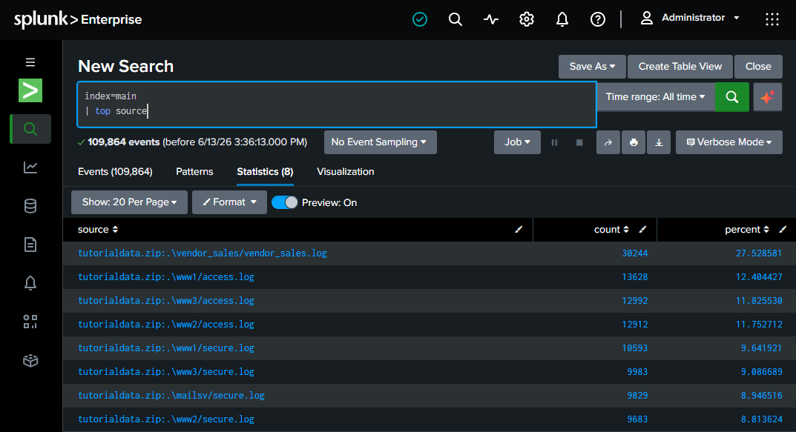
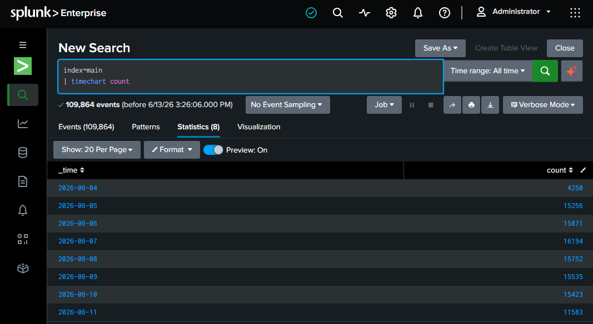
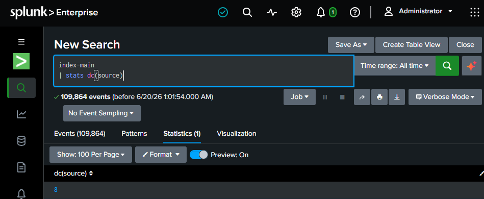
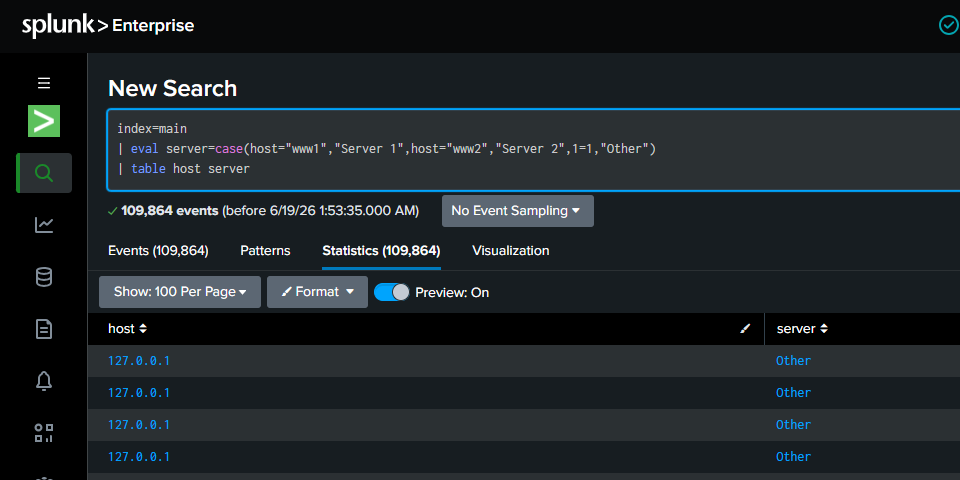
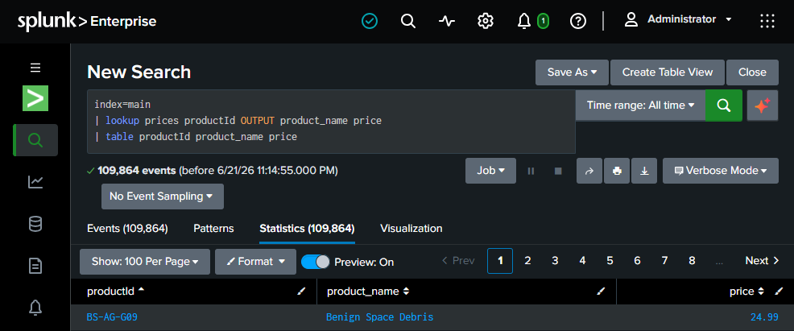
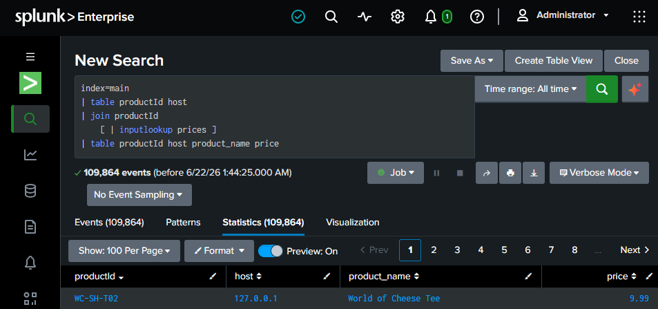
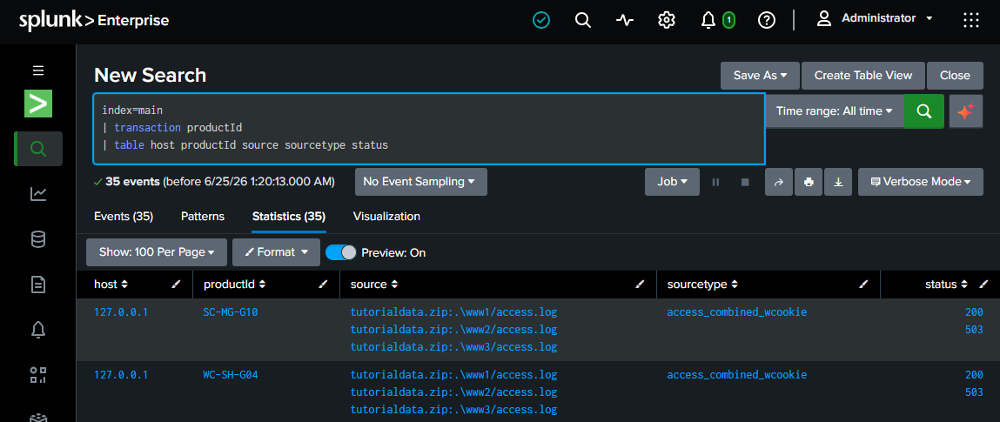
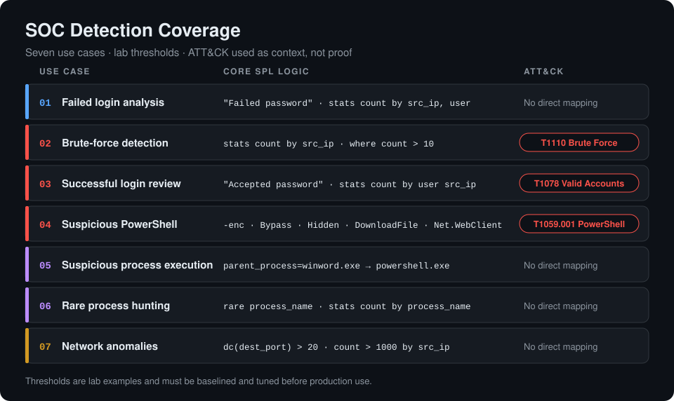
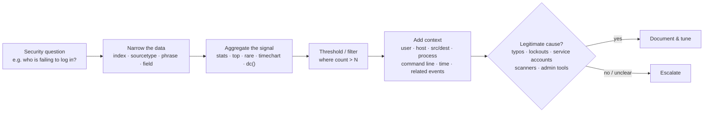

# Splunk SOC Analyst Detection & Investigation Lab


A hands-on **Splunk Enterprise** lab that builds Search Processing Language (SPL) skills from the ground up and then applies them to **seven SOC detection and investigation use cases**: failed-login analysis, brute-force detection, successful-login review, suspicious PowerShell, suspicious parent/child process execution, rare-process hunting and network-connection anomalies.

The fundamentals were practised on Splunk's Buttercup Games tutorial dataset (**109,864 events** across web access, vendor sales and Linux `secure.log` authentication sources) and are documented in **80 screenshots**. Each detection is written up with the security question it answers, the SPL logic, a lab threshold, triage questions, legitimate explanations to rule out, and tuning guidance.

> **Core principle:** a search result is an investigative lead, not proof of compromise. Every detection in this lab is paired with the context an analyst must check before escalating.



## Why I Did This

Knowing SPL commands and running a SOC investigation are two different skills. I wanted to close that gap deliberately: first get fluent in the building blocks (filtering, `stats`, `eval`, lookups, subsearches, transactions, multivalue fields), then use them to answer the questions an analyst actually gets asked on shift, such as "which source is hammering this account?" or "why did Word launch PowerShell?". Writing each use case up with false-positive causes and tuning notes forced me to think like the person who has to decide whether to escalate, not just the person who wrote the query.

## Highlights

- **SPL from fundamentals to analysis:** search and filtering, statistics and visualization, `eval` and time functions, lookups and correlation, result modification and multivalue data, all shown on real tutorial data.
- **Seven documented SOC use cases:** each with objective, SPL, analyst finding, next steps, triage and production considerations.
- **Authentication analysis:** failed-login ranking by source and user, a brute-force threshold, and failure-then-success review.
- **Endpoint behaviour:** PowerShell command-line indicators (`-enc`, `Bypass`, `Hidden`, `DownloadFile`, `Net.WebClient`, `IEX`) and the `winword.exe → powershell.exe` parent/child pattern.
- **Threat hunting:** rare-process analysis with host, user, path, command line, parent and network context.
- **Network analysis:** destination-port diversity (`dc(dest_port) > 20`) and connection-volume (`count > 1000`) heuristics.
- **Measured MITRE ATT&CK mapping:** three techniques mapped where the behaviour supports it; hunting searches deliberately left unmapped rather than overstated.
- **Detection-engineering mindset:** thresholds labelled as lab examples, with explicit tuning and baselining guidance.

## Screenshots

| Time-based analysis: `timechart` | Distinct counts: `stats dc()` |
|---|---|
|  |  |

| Conditional fields: `eval case()` | Enrichment: `lookup` |
|---|---|
|  |  |

| Correlation: `join` with `inputlookup` subsearch | Grouping: `transaction` |
|---|---|
|  |  |

All 80 screenshots, in order and grouped by command, are in the [Evidence Gallery](docs/evidence-gallery.md).

## SOC Detection Use Cases



| # | Use case | Security question | Write-up | SPL |
|---|---|---|---|---|
| 1 | Failed login analysis | Which users or source IPs generate the most authentication failures? | [01](detections/01-failed-logins.md) | [spl](spl/01_failed_logins.spl) |
| 2 | Brute-force detection | Which sources exceed the failed-login threshold? | [02](detections/02-brute-force.md) | [spl](spl/02_brute_force.spl) |
| 3 | Successful login review | Did a successful login follow repeated failures? | [07](detections/07-successful-logins.md) | [spl](spl/03_successful_logins.spl) |
| 4 | Suspicious PowerShell | Are encoded, hidden, bypass or download-oriented commands present? | [03](detections/03-powershell.md) | [spl](spl/04_powershell_detection.spl) |
| 5 | Suspicious process execution | Did Microsoft Word launch PowerShell? | [04](detections/04-suspicious-process.md) | [spl](spl/05_suspicious_process_execution.spl) |
| 6 | Rare process hunting | Which processes are least common, and why are they running? | [05](detections/05-rare-process.md) | [spl](spl/06_rare_processes.spl) |
| 7 | Network anomalies | Is a source touching many ports or producing excessive connections? | [06](detections/06-network-connections.md) | [spl](spl/07_network_connections.spl) |

Example, brute-force detection:

```spl
index=main sourcetype=secure "Failed password"
| stats count by src_ip
| where count > 10
| sort - count
```

## MITRE ATT&CK Mapping

| Detection | Technique | Tactic |
|---|---|---|
| Brute-force detection | T1110 Brute Force | Credential Access |
| Suspicious PowerShell | T1059.001 PowerShell | Execution |
| Successful login after suspicious failures | T1078 Valid Accounts | Defense Evasion, Persistence, Privilege Escalation, Initial Access |

Mappings are investigative context, not proof that a technique occurred. Searches whose telemetry alone cannot establish a specific adversary behaviour are intentionally left unmapped.

## Tools & Technologies

- **Splunk Enterprise:** search, statistics, visualization and lookup management.
- **SPL:** `search`, `where`, `fields`, `table`, `rename`, `sort`, `dedup`, `rex`, `regex`, `stats`, `chart`, `timechart`, `top`, `rare`, `eventstats`, `streamstats`, `eval`, `lookup`, `inputlookup`, `outputlookup`, `join`, `append`, `appendcols`, `appendpipe`, `transaction`, `fillnull`, `replace`, `foreach`, `convert`, `mvexpand`, `makemv`, `makeresults` and macros.
- **Eval functions:** `if()`, `case()`, `coalesce()`, `lower()`, `upper()`, `round()`, `substr()`, `len()`, `split()`, `mvcount()`, `mvindex()`, `relative_time()`, `strftime()`, `strptime()`, `now()`.
- **Data:** Splunk Buttercup Games tutorial data, including Linux `secure.log` authentication events.
- **MITRE ATT&CK:** technique mapping for detection context.

The full command inventory is in the [Splunk Skill Map](docs/splunk-skill-map.md).

## Investigation Flow



## Analyst Workflow

1. **Define the question:** for example, "Which IP generated the most failed logins?"
2. **Narrow the data:** choose the relevant index, sourcetype, authentication phrase, process or network field.
3. **Aggregate the signal:** use `stats`, `top`, `rare`, `timechart` or distinct counts.
4. **Apply a threshold or filter:** use `where` to isolate activity that deserves review.
5. **Add context:** user, host, source and destination, process, command line, time and related events.
6. **Validate before escalating:** rule out legitimate causes and compare against the environment's baseline.

This follows the lifecycle **Detection → Validation → Enrichment → Investigation → Assessment → Escalation**.

## Skill Progression

| Stage | What was practised | Examples |
|---|---|---|
| 1. Search & filtering | Index selection, wildcards, Boolean logic, `IN`, pipes, result shaping, regex | `index=main productId IN (...)`, `rex`, `regex` |
| 2. Statistics & visualization | Summaries, comparisons, trends, frequency analysis, running totals | `stats`, `chart`, `timechart`, `top`, `rare`, `eventstats`, `streamstats` |
| 3. Field creation | Calculated and conditional fields, string and time functions | `eval if()`, `case()`, `coalesce()`, `strftime()` |
| 4. Lookups & correlation | Enrichment and combining searches | `lookup`, `inputlookup`, `outputlookup`, `join`, `appendcols`, `transaction`, subsearches |
| 5. Result & multivalue handling | Cleaning results and splitting multi-value fields | `fillnull`, `replace`, `appendpipe`, `mvexpand`, `makemv`, `makeresults` |
| 6. SOC workflows | Applying all of the above to security questions | The seven detection use cases |

## Repository Structure

```text
splunk-soc-analyst-detection-lab/
├── README.md
├── SOURCE-NOTES.md                     # where the lab material and screenshots came from
├── LICENSE
├── assets/
│   ├── diagrams/
│   │   └── detection-coverage.svg      # use-case coverage diagram
│   ├── image_manifest.csv              # screenshot extraction record
│   └── screenshots/                    # 80 lab screenshots, named by PDF page
├── detections/                         # 7 detection write-ups
│   ├── 01-failed-logins.md
│   ├── 02-brute-force.md
│   ├── 03-powershell.md
│   ├── 04-suspicious-process.md
│   ├── 05-rare-process.md
│   ├── 06-network-connections.md
│   └── 07-successful-logins.md
├── docs/
│   ├── splunk-skill-map.md             # commands and concepts by capability area
│   ├── soc-investigation-notes.md      # triage guidance per use case
│   └── evidence-gallery.md             # all screenshots in page order
└── spl/                                # ready-to-run SPL files
    ├── 00_spl_command_examples.spl
    ├── 01_failed_logins.spl
    ├── 02_brute_force.spl
    ├── 03_successful_logins.spl
    ├── 04_powershell_detection.spl
    ├── 05_suspicious_process_execution.spl
    ├── 06_rare_processes.spl
    └── 07_network_connections.spl
```

## Project Documentation

1. [Splunk Skill Map](docs/splunk-skill-map.md): every command and concept, organised into six capability areas.
2. [SOC Investigation Notes](docs/soc-investigation-notes.md): what to check, and what can legitimately explain each signal.
3. [Detection Write-ups](detections/): seven use cases with SPL, findings, next steps and tuning.
4. [SPL Files](spl/): the searches as standalone `.spl` files.
5. [Evidence Gallery](docs/evidence-gallery.md): all 80 screenshots in page order.
6. [Source Notes](SOURCE-NOTES.md): origin of the lab material and screenshots.

## How to Review

1. **See the fundamentals:** skim the [Evidence Gallery](docs/evidence-gallery.md) to see each SPL command run against the tutorial data.
2. **Read a detection end to end:** start with [Brute-Force Detection](detections/02-brute-force.md) or [Suspicious PowerShell](detections/03-powershell.md) to see the question → SPL → finding → triage → tuning structure.
3. **Check the judgement:** look at how each write-up separates signals from confirmed malicious activity and lists legitimate causes.
4. **Run the searches:** load Splunk's tutorial data and use the files in [`spl/`](spl/). Endpoint and network searches use generic fields (`process_name`, `parent_process`, `command_line`, `src_ip`, `dest_ip`, `dest_port`, `protocol`); map them to your Sysmon, Windows Event Log, EDR or firewall field names before use.

## Detection Engineering Note

Thresholds in this lab, such as 10 failed logins, 20 distinct destination ports or 1,000 connections, are **learning examples, not production rules**. A real SOC should tune them against its own baseline, authentication model, service accounts, scanners, administrative tools and normal network behaviour, so that false positives drop without losing meaningful signal.

## Skills Demonstrated

- **SIEM operations:** Splunk Enterprise searching, statistics, visualization and lookups.
- **SPL proficiency:** filtering, aggregation, field engineering, enrichment, correlation and multivalue handling.
- **Authentication monitoring:** failed-login ranking, brute-force thresholds and failure-then-success review.
- **Endpoint detection:** PowerShell command-line indicators and suspicious parent/child process chains.
- **Threat hunting:** frequency-based rare-process analysis with contextual triage.
- **Network analysis:** port-diversity and connection-volume heuristics.
- **Alert triage:** separating signals from confirmed activity and ruling out legitimate causes.
- **Detection engineering:** thresholds, baselining and tuning to reduce false positives.
- **Threat framework mapping:** MITRE ATT&CK applied only where evidence supports it.
- **Technical documentation:** repeatable, structured detection write-ups.

## Roadmap

- Add result screenshots for each of the seven detection use cases
- Run the endpoint detections against Sysmon or Windows Security data and map fields accordingly
- Build a Splunk dashboard combining the authentication, PowerShell and network panels
- Convert the detections into saved searches with alert actions
- Add Sigma equivalents for the PowerShell and process-execution detections

---

## Disclaimer

This project was performed entirely in a controlled lab environment for education, SOC training and portfolio purposes, using Splunk tutorial data. Detection logic and thresholds are lab examples and must be validated, baselined and tuned before production use. No real systems, organizations, accounts or third-party data were targeted.

---

## Author

**Anik Nohan**

This lab was built to practise and demonstrate real-world SOC analyst skills in:

- Splunk Enterprise and Search Processing Language (SPL)
- SIEM monitoring and alert triage
- Authentication, endpoint and network detection
- Threat hunting and behavioural baselining
- Detection tuning and false-positive analysis
- MITRE ATT&CK mapping and investigation documentation

Also see my **[Windows DFIR Security Event Investigation](https://github.com/aniknohan/windows-dfir-security-event-investigation)**, **[Report Writing Using Phishing Tools](https://github.com/aniknohan/report-writing-using-phishing-tools)** and **[CyberHire AI Cybersecurity Interview Simulator](https://github.com/aniknohan/cyberhire-windows-ai-lab)**.

### Tools Used

`Splunk Enterprise` • `SPL` • `SIEM` • `MITRE ATT&CK` • `GitHub`

## License

Released under the [MIT License](LICENSE).
